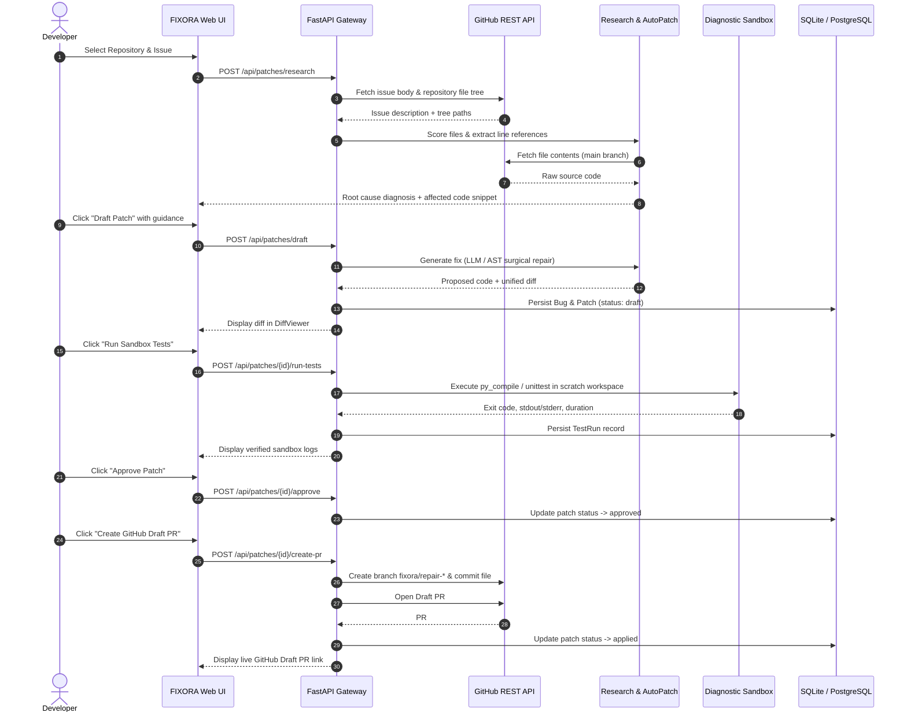

# FIXORA — Autonomous Code Repair & Incident Intelligence Platform

> **UNDERSTAND THE CODE • ISOLATE THE ROOT CAUSE • SYNTHESIZE THE FIX • VALIDATE IN SANDBOX • KEEP THE DEVELOPER IN CONTROL.**

FIXORA is an enterprise software engineering platform that unifies repository intelligence, multi-agent AI orchestration, and isolated sandbox verification to autonomously detect, diagnose, repair, and test software defects before generating human-reviewable GitHub Pull Requests.

---

## Table of Contents

- [Overview](#overview)
- [Problem Statement](#problem-statement)
- [The Solution](#the-solution)
- [Key Features](#key-features)
- [How FIXORA Works](#how-fixora-works)
- [Core Autonomous Repair Workflow](#core-autonomous-repair-workflow)
- [Architecture & Tech Stack](#architecture--tech-stack)
- [Installation & Setup](#installation--setup)
- [Environment Configuration](#environment-configuration)
- [Running the Application](#running-the-application)
  - [1. Backend API](#1-backend-api)
  - [2. Frontend UI](#2-frontend-ui)
  - [3. Docker Compose (Full Stack)](#3-docker-compose-full-stack)
- [Connecting a GitHub Repository](#connecting-a-github-repository)
- [AutoPatch Studio Walkthrough](#autopatch-studio-walkthrough)
- [Security & Governance](#security--governance)
- [Platform Verification & Test Results](#platform-verification--test-results)
- [Technical Documentation Suite](#technical-documentation-suite)
- [Contributing](#contributing)

---

## Overview

Modern engineering teams spend up to 40% of their development bandwidth diagnosing runtime crashes, reproducing edge cases, and manually authoring defensive patches. 

FIXORA bridges the gap between observability and code remediation. It connects directly to your GitHub repositories, ingests real issue reports and stack traces, isolates the defect to exact source lines, generates an AST-validated patch, runs the patch through an isolated verification sandbox, and opens a real GitHub Draft PR — requiring explicit human review before any code is committed.

---

## Problem Statement

1. **Triage Fatigue:** SREs and developers spend hours deciphering cryptic stack traces, searching through hundreds of repository files, and correlating telemetry to find the root cause.
2. **Hallucinated or Generic AI Fixes:** General-purpose AI chatbots produce out-of-context snippets that do not match the repository's coding standards or fail to compile.
3. **Unverified Patches:** Automated fixes without isolated test validation risk introducing subtle regressions or runtime syntax errors.
4. **Lack of Human Governance:** Fully autonomous commits directly to production branches create compliance, security, and stability hazards.

---

## The Solution

FIXORA provides a closed-loop autonomous repair pipeline:

```
[ GitHub Issue / Incident ]
           │
           ▼
[ Autonomous Research ] ──> Pinpoints affected file & line numbers (#L123)
           │
           ▼
[ Patch Drafting ] ───────> LLM code generation + AST surgical repair
           │
           ▼
[ Sandbox Validation ] ───> Executes py_compile & test suite in isolated runner
           │
           ▼
[ Human Approval Gate ] ──> Engineering Lead approves the unified diff
           │
           ▼
[ GitHub Draft PR ] ──────> Creates branch fixora/repair-* and opens draft PR
```

---

## Key Features

- **Live GitHub Repository Sync:** Ingests repository metadata, default branches, recursive git trees (250+ files), commit history, and language detection.
- **Real GitHub Issues Integration:** Queries and filters open/closed issues directly from the GitHub REST API, excluding pull requests.
- **Context-Aware Autonomous Research:**
  - Extracts stack trace paths and line numbers (e.g. `#L42`, `line 15`).
  - Multi-signal file relevance scoring (`+200` for explicit issue mentions, `+100` for filename token matches).
  - Retrieves actual file contents from GitHub and centers snippets around the affected region.
- **Intelligent Patch Drafting:**
  - Synthesizes candidate fixes using Google Gemini 2.5 Flash or OpenAI GPT-4o-mini.
  - Native AST surgical repair fallback: uses Python's `ast` module to locate the target function and inject defensive parameter guards inside function scope.
- **Interactive Diff Viewer:** Side-by-side and unified diff visualization comparing original source lines against proposed changes.
- **Isolated Sandbox Execution:**
  - Enforces strict command allowlists (`pytest`, `python -m unittest`, `python -m py_compile`).
  - Disallows shell injections and command chaining (`;`, `&&`, `|`, `` ` ``).
  - Executes tests inside ephemeral sandboxes with execution timeouts and resource limits.
- **Strict Human-in-the-Loop Governance:**
  - Never mutates remote git branches without explicit human approval.
  - Records reviewer identity, timestamp, and verification logs in the audit log.
- **Real GitHub Draft Pull Requests:**
  - Creates a dedicated working branch (`fixora/repair-<id>`).
  - Base64 encodes and commits the patched file via the GitHub Contents API.
  - Opens a real Draft PR on GitHub with structured RCA findings and sandbox logs.
- **LangGraph Multi-Agent Incident Orchestration:**
  - 7 sequential stateful agents: Triage → Retrieval → RCA → Diagnostic → AutoPatch → Validation → Postmortem.

---

## How FIXORA Works

FIXORA operates in two complementary modes:

### 1. Pre-Deployment Mode (Repository Issues & Code Repair)
- **Input:** A connected GitHub repository and an open issue or bug description.
- **Execution:** AutoPatch Studio inspects the repository's git tree, scores candidate source files, pulls real code from GitHub, formulates the root cause, synthesizes a targeted unified diff, and verifies compilation.

### 2. Post-Deployment Mode (Incident Intelligence & Anomaly Remediation)
- **Input:** Live error logs, HTTP 500 surges, or database timeout events forwarded via REST or webhook.
- **Execution:** The LangGraph multi-agent engine triages the incident, correlates error signatures, retrieves relevant architectural context via Hybrid RAG, generates a candidate patch, validates it in the sandbox, and produces a comprehensive postmortem report.

---

## Core Autonomous Repair Workflow



---

## Architecture & Tech Stack

| Layer | Technologies | Role |
| :--- | :--- | :--- |
| **Frontend UI** | React 19, TypeScript 5.7, Vite 6, Tailwind CSS, Lucide Icons | Responsive dashboard, DiffViewer, AutoPatch Studio, Issues page |
| **Backend API** | Python 3.12, FastAPI, Pydantic v2, Uvicorn | Async REST API gateway, OpenAPI docs, middleware, auth |
| **Persistence** | SQLite (`aiosqlite`) / PostgreSQL 16 (`asyncpg`), SQLAlchemy 2.0 | Async ORM, relational schema for repositories, bugs, patches, runs |
| **AI & Reasoning** | Google Gemini 2.5 Flash, OpenAI GPT-4o-mini, Python `ast` | Multi-provider code generation with AST-based fallback |
| **Orchestrator** | LangGraph (`StateGraph`) | 7-agent stateful incident triage, RCA, and postmortem pipeline |
| **Vector Store** | Qdrant Vector DB (Dense 384-d vectors) + In-Memory Fallback | Semantic knowledge indexing and retrieval with graceful offline fallback |
| **Lexical Search** | Okapi BM25 (`rank-bm25`) + Reciprocal Rank Fusion | Hybrid lexical + semantic document search |
| **Execution Sandbox** | Python `tempfile`, `subprocess`, `py_compile`, Docker | Isolated execution environment with resource and command limits |

---

## Installation & Setup

### Prerequisites

- **Python 3.12+**
- **Node.js 18+ & npm 9+**
- **Git**
- *(Optional)* Docker Desktop (for containerized deployments)

### 1. Clone the Repository

```bash
git clone https://github.com/Uday-MS/fixora.git
cd fixora
```

### 2. Set Up Python Backend Virtual Environment

```bash
# Create virtual environment
python3 -m venv backend/venv

# Activate virtual environment
source backend/venv/bin/activate  # macOS / Linux
# or: backend\venv\Scripts\activate  # Windows

# Install backend dependencies
pip install -r backend/requirements.txt
```

### 3. Set Up Frontend Dependencies

```bash
# Install frontend packages
npm --prefix frontend install
```

---

## Environment Configuration

Copy the example configuration to create your local `.env`:

```bash
cp .env.example .env
```

### Key Configuration Variables

| Variable | Description | Default / Example |
| :--- | :--- | :--- |
| `DATABASE_URL` | Async database connection URL | `sqlite+aiosqlite:///./fixora.db` |
| `JWT_SECRET` | Secret key for signing authentication tokens | Auto-generated 64-char key |
| `GITHUB_TOKEN` | GitHub Personal Access Token (for private repos & PRs) | `ghp_...` (optional for public repos) |
| `GITHUB_WEBHOOK_SECRET` | Secret for validating incoming GitHub webhooks | Auto-generated 64-hex key |
| `GEMINI_API_KEY` | Google Gemini API key for AI patch generation | `AIza...` (optional, AST fallback active) |
| `OPENAI_API_KEY` | OpenAI API key for AI patch generation | `sk-...` (optional, AST fallback active) |
| `QDRANT_URL` | Remote Qdrant vector database URL | `http://localhost:6333` |
| `VITE_API_URL` | Base API URL for frontend client | `/api` |

> [!NOTE]
> FIXORA works out of the box with zero external API keys. When AI provider keys are absent, patch generation uses deterministic AST surgical repair. When a GitHub Token is omitted, public repositories are accessed via the public GitHub API within rate limits.

---

## Running the Application

### 1. Backend API

```bash
# Launch FastAPI server with auto-reload
PYTHONPATH=backend backend/venv/bin/uvicorn app.main:app --host 127.0.0.1 --port 8000 --reload
```
- API Gateway: **`http://127.0.0.1:8000`**
- Swagger Interactive Docs: **`http://127.0.0.1:8000/docs`**
- System Diagnostics & Verification: **`http://127.0.0.1:8000/api/settings/validate`**

### 2. Frontend UI

```bash
# In a separate terminal
npm --prefix frontend run dev
```
- Web Application: **`http://localhost:5173`**

### 3. Docker Compose (Full Stack)

To run the complete production stack (PostgreSQL, Redis, Qdrant, Backend, and Frontend):

```bash
docker compose up -d --build
```

### 4. Deploy to Render (Production Cloud)

FIXORA includes a turnkey Infrastructure-as-Code Blueprint (`render.yaml`) for 1-click deployment on Render:

1. Push your code to your GitHub repository.
2. In the [Render Dashboard](https://dashboard.render.com), click **New +** → **Blueprint**.
3. Select your `fixora` repository and click **Apply**.
4. For manual step-by-step instructions, environment variable setup, and database provisioning, see **[RENDER_DEPLOYMENT_MANUAL_STEPS.md](RENDER_DEPLOYMENT_MANUAL_STEPS.md)**.

---

## Connecting a GitHub Repository

1. Open FIXORA in your browser at `http://localhost:5173`.
2. Navigate to **Repositories** in the sidebar.
3. Click **Connect Repository**.
4. Enter any public GitHub repository URL (e.g. `https://github.com/ML4SCI/DeepLense-AI-Scientist` or `https://github.com/owner/repo`).
5. Click **Connect & Sync**.
6. FIXORA will fetch metadata, branches, the git file tree, and open issues.

---

## AutoPatch Studio Walkthrough

1. Navigate to **AutoPatch Studio** (`/autopatch`).
2. Select your connected repository from the dropdown.
3. Choose an open issue from the live issues list (e.g., `#34`).
4. Click **Run Autonomous Research**:
   - FIXORA inspects the issue body, extracts referenced files and line numbers, and fetches real code from GitHub.
5. Review the diagnosed root cause and affected code snippet.
6. Provide optional developer guidance and click **Draft Patch**:
   - The engine generates a surgical, minimal diff and loads it into the interactive **Diff Viewer**.
7. Click **Run Sandbox Tests**:
   - An isolated temporary environment compiles the code and executes test assertions, displaying real stdout/stderr.
8. Click **Approve Patch** to record human engineering verification.
9. Click **Create GitHub Draft PR**:
   - FIXORA pushes the patch to a new branch and opens a real Draft PR on GitHub.

---

## Security & Governance

- **Mandatory Human-in-the-Loop:** Automated fixes cannot be pushed to remote GitHub repositories without explicit developer approval via the UI or API.
- **Isolated Sandbox Execution:** Test runs execute in scratch directories with resource caps, non-root users, strict timeouts (15s), and shell injection filtering.
- **Secrets Protection:** High-entropy JWT secrets and webhook secrets are generated locally and excluded from Git via `.gitignore`.
- **Zip Slip Defense:** Archive extraction algorithms validate canonical path boundaries to prevent directory traversal vulnerabilities.
- **Principle of Least Privilege:** GitHub integrations only require `repo` and `read:org` scopes.

---

## Platform Verification & Test Results

The platform has been independently verified through automated regression suites and production builds:

```text
============================= test session starts ==============================
platform darwin -- Python 3.12.13, pytest-9.2.0, pluggy-1.7.0
rootdir: /Users/udayms/NEW/FIXORA/backend
configfile: pytest.ini
collected 41 items

backend/tests/test_backend.py ................                           [ 39%]
backend/tests/test_e2e_journey.py ....                                   [ 48%]
backend/tests/test_ingestion_and_telemetry.py .......                    [ 65%]
backend/tests/test_multi_agent_orchestrator.py .....                     [ 78%]
backend/tests/test_rag_engine.py .........                               [100%]

======================== 41 passed, 1 warning in 1.59s =========================
```

- **Frontend Build:** `tsc -b && vite build` completed with **0 errors** (1684 modules transformed).
- **Live Configuration Validation:** `GET /api/settings/validate` returns `200 OK` with database, JWT, sandbox, and environment diagnostics verified.

---

## Technical Documentation Suite

For comprehensive architectural specifications and deep-dive documentation, explore the `docs/` directory:

| Document | Description |
| :--- | :--- |
| **[01. Project Overview](docs/PROJECT_OVERVIEW.md)** | Problem statement, target personas, and value delivery |
| **[02. Tech Stack Matrix](docs/TECH_STACK.md)** | Detailed library versions and component lifecycle status |
| **[03. System Architecture](docs/SYSTEM_ARCHITECTURE.md)** | 10 comprehensive Mermaid architecture and data flow diagrams |
| **[04. Data Flow & Pipelines](docs/DATA_FLOW_AND_PIPELINES.md)** | Step-by-step life-of-a-request across all platform workflows |
| **[05. Feature Documentation](docs/FEATURE_DOCUMENTATION.md)** | Complete guide to UI pages, controls, and workflows |
| **[06. Database Architecture](docs/DATABASE_ARCHITECTURE.md)** | SQLAlchemy models, ER diagrams, and relational schemas |
| **[07. API Reference](docs/API_REFERENCE.md)** | REST endpoint catalog, Pydantic schemas, and status codes |
| **[08. AI & RAG Architecture](docs/AI_AND_RAG_ARCHITECTURE.md)** | LangGraph agents, Qdrant vector retrieval, and BM25 ranking |
| **[09. Security & Reliability](docs/SECURITY_AND_RELIABILITY.md)** | Sandbox isolation, Zip Slip guards, and RBAC governance |
| **[10. Feature Status Matrix](docs/FEATURE_STATUS.md)** | Master readiness matrix with strict verification status labels |
| **[11. Local Setup Guide](docs/LOCAL_SETUP_GUIDE.md)** | Turnkey setup runbook and troubleshooting steps |
| **[12. Hackathon Demo Guide](docs/HACKATHON_DEMO_GUIDE.md)** | Live demonstration script and stage talking points |
| **[13. Hackathon Judge Q&A](docs/HACKATHON_QA.md)** | 22 in-depth architectural questions and technical defense answers |

---

## Contributing

1. Fork the repository.
2. Create a feature branch (`git checkout -b feature/amazing-feature`).
3. Commit your changes (`git commit -m 'feat: add amazing feature'`).
4. Ensure all tests pass (`PYTHONPATH=backend pytest backend/tests` and `npm --prefix frontend run build`).
5. Push to the branch (`git push origin feature/amazing-feature`).
6. Open a Pull Request.
