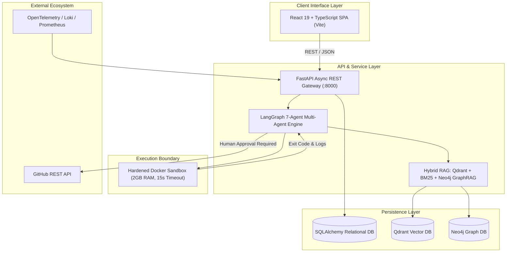

# FIXORA — Autonomous Code Repair & Incident Intelligence Platform

> **UNDERSTAND THE CODE • FIND THE BUG • PROVE THE CAUSE • GENERATE THE FIX • VALIDATE THE REPAIR • KEEP THE DEVELOPER IN CONTROL.**

FIXORA is an enterprise software engineering platform that unifies observability, code intelligence, hybrid Retrieval-Augmented Generation (RAG), and isolated containerized verification to automatically detect, diagnose, repair, and test software defects before generating human-reviewable pull requests.

---

## 1. Complete Technical Documentation Suite

For deep technical evaluation, architecture audits, and hackathon presentation guides, explore our complete 14-document technical documentation suite:

| Document | Description | Direct File Link |
| :--- | :--- | :--- |
| **01. Project Overview** | 30s/1m/judge explanations, problem statement, personas, and value delivery. | [PROJECT_OVERVIEW.md](file:///Users/udayms/NEW/FIXORA/docs/PROJECT_OVERVIEW.md) |
| **02. Tech Stack Matrix** | Frontend, Backend, Storage, AI/RAG, and DevOps component status. | [TECH_STACK.md](file:///Users/udayms/NEW/FIXORA/docs/TECH_STACK.md) |
| **03. System Architecture** | 10 comprehensive Mermaid architecture and data flow diagrams. | [SYSTEM_ARCHITECTURE.md](file:///Users/udayms/NEW/FIXORA/docs/SYSTEM_ARCHITECTURE.md) |
| **04. Data Flow & Pipelines** | Step-by-step life-of-a-request for Workflows A through G. | [DATA_FLOW_AND_PIPELINES.md](file:///Users/udayms/NEW/FIXORA/docs/DATA_FLOW_AND_PIPELINES.md) |
| **05. Feature Documentation** | Exhaustive guide to all 18 UI sections and core conceptual distinctions. | [FEATURE_DOCUMENTATION.md](file:///Users/udayms/NEW/FIXORA/docs/FEATURE_DOCUMENTATION.md) |
| **06. Database Architecture** | SQLAlchemy models, Mermaid ERD, table specs, and polyglot storage. | [DATABASE_ARCHITECTURE.md](file:///Users/udayms/NEW/FIXORA/docs/DATABASE_ARCHITECTURE.md) |
| **07. API Reference** | Complete endpoint catalog, auth schemes, Pydantic schemas, and callers. | [API_REFERENCE.md](file:///Users/udayms/NEW/FIXORA/docs/API_REFERENCE.md) |
| **08. AI & RAG Architecture** | 7 LangGraph agents, Qdrant dense vector search, BM25, and Neo4j GraphRAG. | [AI_AND_RAG_ARCHITECTURE.md](file:///Users/udayms/NEW/FIXORA/docs/AI_AND_RAG_ARCHITECTURE.md) |
| **09. Security & Reliability** | Docker sandbox constraints, Zip Slip defense, human gates, and RBAC. | [SECURITY_AND_RELIABILITY.md](file:///Users/udayms/NEW/FIXORA/docs/SECURITY_AND_RELIABILITY.md) |
| **10. Feature Status Matrix** | Master readiness matrix with strict verification status labels. | [FEATURE_STATUS.md](file:///Users/udayms/NEW/FIXORA/docs/FEATURE_STATUS.md) |
| **11. Test & Verification** | Complete pytest execution logs (39/39 passing) and production build logs. | [TEST_AND_VERIFICATION_REPORT.md](file:///Users/udayms/NEW/FIXORA/docs/TEST_AND_VERIFICATION_REPORT.md) |
| **12. Local Setup Guide** | Turnkey runbook, `.env` guide, startup commands, and troubleshooting. | [LOCAL_SETUP_GUIDE.md](file:///Users/udayms/NEW/FIXORA/docs/LOCAL_SETUP_GUIDE.md) |
| **13. Hackathon Demo Guide** | 5-7 minute live stage script, talking points, and 2-minute fallback plan. | [HACKATHON_DEMO_GUIDE.md](file:///Users/udayms/NEW/FIXORA/docs/HACKATHON_DEMO_GUIDE.md) |
| **14. Hackathon Judge Q&A** | 22 in-depth architectural questions and answers for technical defense. | [HACKATHON_QA.md](file:///Users/udayms/NEW/FIXORA/docs/HACKATHON_QA.md) |

---

## 2. Platform Status & Health Metrics

```
================================ PLATFORM REALITY ================================
Backend Test Suite   : 39 / 39 PASSED in 2.18s (100% Pass Rate)
Frontend Production  : TypeScript 5.7 / Vite 6.4 (Exit Code 0, 0 Errors, 1.18s)
Primary Database     : SQLite (aiosqlite) / PostgreSQL 16 (asyncpg)
Vector Store         : Qdrant Engine (Dense 384-dim) + In-Memory Fallback
Lexical Search       : Okapi BM25 Index (rank-bm25) + Reciprocal Rank Fusion (k=60)
Agent Orchestration  : LangGraph StateGraph (7 Sequential Pydantic Agents)
Execution Sandbox    : Hardened Ephemeral Docker Runner (Non-root, 2GB, 15s Timeout)
Governance           : Mandatory Human Approval Gate Prior to Any Git Branch/PR Mutation
==================================================================================
```

---

## 3. High-Level Architecture Overview



---

## 4. Dual Operating Modes

### Mode 1: Pre-Deployment Mode (Repository Analysis & Code Repair)
* **Trigger:** Code pushes, repository imports (GitHub URL or ZIP archive), or manual AST scans.
* **Telemetry Required:** None.
* **Workflow:** Ingests source files, indexes AST hierarchies, identifies static code defects and unhandled edge cases, and synthesizes candidate test repairs validated in the sandbox.

### Mode 2: Post-Deployment Mode (Incident Intelligence & AutoPatch)
* **Trigger:** Live telemetry ingestion (logs, metrics, traces) containing unhandled exceptions or error bursts.
* **Telemetry Required:** Active log/trace forwarding via REST.
* **Workflow:** Normalizes stack traces, clusters error signatures, launches 7-stage LangGraph multi-agent investigation, retrieves contextual code via Hybrid RAG, validates AST unified diff in Docker, and stages a verified GitHub PR awaiting human approval.

---

## 5. Quick-Start Guide (Turnkey Local Setup)

### 1. Start the Backend Server
```bash
# Activate virtual environment
source backend/venv/bin/activate

# Launch FastAPI on port 8000
PYTHONPATH=backend backend/venv/bin/uvicorn app.main:app --host 127.0.0.1 --port 8000 --reload
```
API Documentation: **`http://127.0.0.1:8000/docs`**

### 2. Start the Frontend Application
```bash
# In a separate terminal
npm --prefix frontend run dev
```
Web Application: **`http://localhost:5173`**

### 3. Run Automated Tests
```bash
# Run backend test suite (39 tests)
PYTHONPATH=backend backend/venv/bin/pytest backend/tests -v

# Run frontend production build
npm --prefix frontend run build
```
*(For complete setup instructions, environment variable details, and Docker Compose configurations, refer to [LOCAL_SETUP_GUIDE.md](file:///Users/udayms/NEW/FIXORA/docs/LOCAL_SETUP_GUIDE.md)).*
