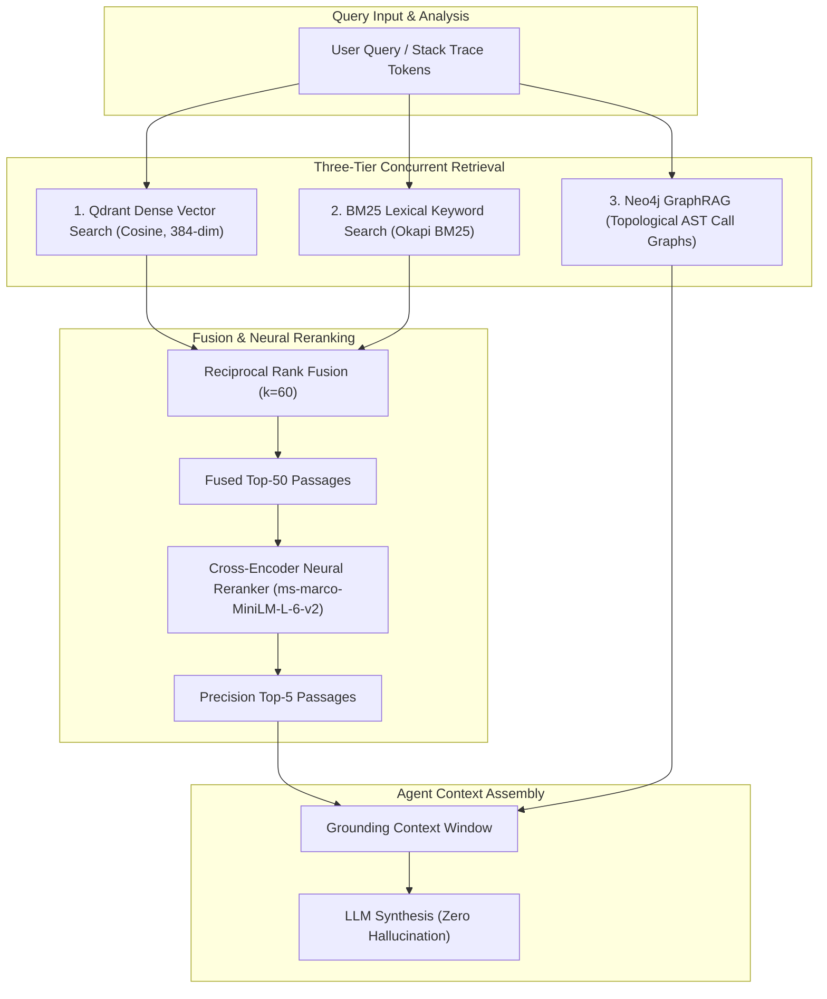

# FIXORA — AI, Multi-Agent & Hybrid RAG Architecture

> **Deterministic Multi-Agent StateGraph, Multi-Modal Retrieval & Governed Code Synthesis**  
> *Deep technical dive into LangGraph state machines, Qdrant dense vector search, BM25 lexical ranking, Neo4j GraphRAG, and Docker validation.*

---

## 1. The Multi-Agent Philosophy: Determinism Over Free-Form Chat

Standard conversational LLM interfaces fail in mission-critical software engineering because they exhibit unbounded conversational drift, hallucinate nonexistent APIs, and lack grounding in the project's actual execution environment. 

FIXORA replaces unstructured conversation with a **Deterministic Multi-Agent StateGraph** built on LangGraph. The platform structures incident remediation as a 7-stage directed workflow where each specialized agent operates within a strictly defined Pydantic state contract.

```mermaid
flowchart LR
    A["1. Triage Agent"] --> B["2. Retrieval Agent"]
    B --> C["3. RCA Agent"]
    C --> D["4. Diagnostic Agent"]
    D --> E["5. AutoPatch Agent"]
    E --> F["6. Validation Agent"]
    F -->|Tests Pass| G["7. Postmortem Agent"]
    F -->|Tests Fail (Retry <= 3)| E
```

---

## 2. Deep Dive: The 7 LangGraph Agents

```
+-----------------------------------------------------------------------------------+
|                        THE 7-STAGE AGENT PIPELINE SPEC                            |
+-----------------------------------------------------------------------------------+
| 1. Triage Agent       : Severity classification, stack trace scrubbing, scoping    |
| 2. Retrieval Agent    : Hybrid RAG (Qdrant + BM25 + Neo4j GraphRAG)                |
| 3. RCA Agent          : Hypothesis formulation, AST node localization             |
| 4. Diagnostic Agent   : Targeted test synthesis, reproduction assertion            |
| 5. AutoPatch Agent    : Unified diff code patch synthesis                          |
| 6. Validation Agent   : Ephemeral Docker sandbox execution (pytest)                |
| 7. Postmortem Agent   : Incident summary, timeline, binary PDF export              |
+-----------------------------------------------------------------------------------+
```

### Agent 1: Triage Agent
* **Input State:** Raw incident log, telemetry payload, or pre-deployment bug report.
* **Responsibilities:**
  - Extracts and normalizes stack trace frames using regular expression scrubbers.
  - Identifies target repository, microservice, language, and framework.
  - Computes incident severity level (`P1` to `P4`) based on error frequency and service criticality.
* **Output State Transition:** Sets `state.triage_completed = True`, populates `state.error_signature`, and passes control to Agent 2.

### Agent 2: Retrieval Agent
* **Input State:** Scrubbed stack trace, target file paths, and exception signature.
* **Responsibilities:**
  - Queries Qdrant for semantic code chunks surrounding the stack trace.
  - Queries BM25 index using extracted function and class tokens.
  - Queries Neo4j (or in-memory NetworkX) to traverse call-graph relationships (callers and downstream callees).
  - Retrieves relevant architecture guidelines and historical postmortems from the Knowledge Base.
  - Executes Reciprocal Rank Fusion ($k=60$) and Cross-Encoder neural reranking to select the top 5 high-relevance code passages.
* **Output State Transition:** Appends retrieved chunks to `state.retrieved_context` and passes control to Agent 3.

### Agent 3: Root Cause Analysis (RCA) Agent
* **Input State:** Error context + Top-5 retrieved code and architecture snippets.
* **Responsibilities:**
  - Analyzes the logic flow leading to the unhandled exception (e.g. `NoneType` attribute access, unvalidated dictionary key, zero division, database transaction timeout).
  - Pinpoints the offending AST node, file path, and line range.
  - Formulates a deterministic, falsifiable hypothesis explaining the defect.
* **Output State Transition:** Writes `state.rca_hypothesis` and `state.root_cause_file_range` and passes control to Agent 4.

### Agent 4: Diagnostic Agent
* **Input State:** RCA hypothesis and target source file context.
* **Responsibilities:**
  - Designs a minimal, isolated regression test case that reproduces the failure.
  - Formulates assertions that currently evaluate to `False` on the buggy code but will evaluate to `True` once corrected.
* **Output State Transition:** Sets `state.repro_test_code` and passes control to Agent 5.

### Agent 5: AutoPatch Agent
* **Input State:** Buggy source file, RCA hypothesis, and reproduction test specification.
* **Responsibilities:**
  - Synthesizes a surgical code repair strictly formatted as a standard unified diff (`--- a/... +++ b/... @@ ... @@`).
  - Follows strict defensive programming guidelines: null checks, type guards, boundary validation, and exception handling.
  - Prohibits wholesale file rewrites or extraneous formatting alterations.
* **Output State Transition:** Sets `state.candidate_diff` and passes control to Agent 6.

### Agent 6: Validation Agent (The Execution Gate)
* **Input State:** Candidate unified diff + project test suite.
* **Responsibilities:**
  - Submits the candidate diff to `SandboxService`.
  - Mounts the modified codebase into an isolated, non-root Docker container with bounded RAM (2048 MB) and execution timeout (15s).
  - Executes the target test runner (`pytest`).
  - Inspects container exit code, `stdout`, and `stderr`.
* **Branching Logic:**
  - **If Exit Code == 0 (Tests Pass):** Sets `state.validation_status = "passed"` and transitions to Agent 7.
  - **If Exit Code != 0 (Tests Fail):** Increments `state.iteration_count`. If iterations $\le 3$, feeds execution `stderr` back to Agent 5 (AutoPatch) for self-correction. If iterations $> 3$, marks investigation as `validation_failed`.

### Agent 7: Postmortem Agent
* **Input State:** Validated patch, test output, incident logs, and RCA findings.
* **Responsibilities:**
  - Synthesizes an executive incident summary, timeline, root-cause statement, and preventative action items.
  - Persists the postmortem record in the `reports` table.
  - Stages the patch for Human-in-the-Loop review in AutoPatch Studio.
* **Output State Transition:** Completes workflow (`state.status = "completed"`).

---

## 3. LangGraph State Contract (`InvestigationState`)

```python
class InvestigationState(BaseModel):
    incident_id: Optional[str] = None
    bug_id: Optional[str] = None
    repository_id: str
    error_signature: str
    raw_stack_trace: str
    triage_summary: Optional[str] = None
    retrieved_context: List[Dict[str, Any]] = Field(default_factory=list)
    rca_hypothesis: Optional[str] = None
    target_file: Optional[str] = None
    target_line_range: Optional[Tuple[int, int]] = None
    repro_test_code: Optional[str] = None
    candidate_diff: Optional[str] = None
    iteration_count: int = 0
    validation_status: str = "pending"  # pending, passed, failed
    test_stdout: Optional[str] = None
    test_stderr: Optional[str] = None
    postmortem_id: Optional[str] = None
    status: str = "running"
```

---

## 4. Multi-Modal Hybrid RAG Architecture



### Reciprocal Rank Fusion (RRF) Mathematical Formulation
To eliminate bias between score scales of dense vector cosine distances (bounded $[-1, 1]$) and BM25 term scores (unbounded $[0, \infty)$), FIXORA applies Reciprocal Rank Fusion with constant $k=60$:

$$RRF\_Score(d \in D) = \sum_{m \in \{dense, lexical\}} \frac{1}{60 + r_m(d)}$$

Where:
* $d$ is a retrieved code snippet or document.
* $m$ represents the retrieval modality.
* $r_m(d)$ is the 1-based rank position of document $d$ within modality $m$'s result set.

---

## 5. Hallucination Prevention & Context Grounding

FIXORA enforces four structural defenses to ensure generated patches are technically valid and free of hallucinated symbols:
1. **Strict Context Windows:** The AutoPatch prompt receives only verified source code from the active repository. The system prompt instructs: *"You may ONLY invoke functions, imports, and variables that exist in the provided source code or standard library."*
2. **AST Linting Pre-Check:** Before passing candidate diffs to the Docker sandbox, an in-process AST parser verifies that modified files parse without syntax errors.
3. **Compulsory Test Execution:** Patches cannot be approved without an associated `test_runs` record demonstrating exit code 0 in the sandbox.
4. **Mandatory Human-in-the-Loop Approval:** No automated system can directly mutate a Git branch or publish a pull request. An engineer must physically click "Approve Patch" in the UI.
