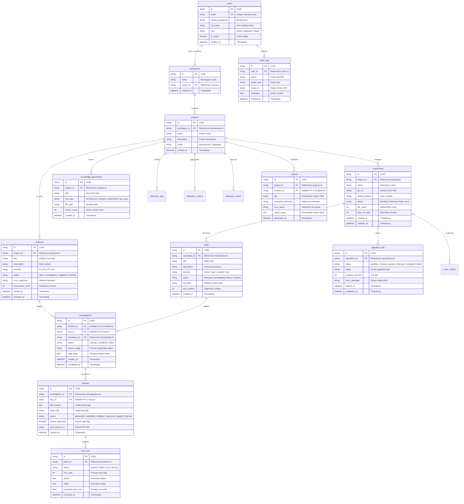

# FIXORA — Database Architecture & Data Modeling Specification

> **Comprehensive Relational Schema, Multi-Model Storage Topologies & Entity Relationships**  
> *Detailed analysis of SQLAlchemy models, indexes, cascading behaviors, and polyglot persistence.*

---

## 1. Storage Topology Overview

FIXORA employs a polyglot persistence architecture designed for operational reliability, sub-millisecond retrieval, and horizontal scaling:

```
+-----------------------------------------------------------------------------------+
|                            STORAGE ARCHITECTURE TIERS                             |
+-----------------------------------------------------------------------------------+
| 1. Primary Relational Store: SQLite (Local/Demo) & PostgreSQL 16 (Enterprise)      |
|    - Engine: SQLAlchemy 2.0 Async (aiosqlite / asyncpg)                           |
|    - Scope: Users, Workspaces, Repos, Bugs, Patches, Incidents, Reports, Audits    |
+-----------------------------------------------------------------------------------+
| 2. Vector Database: Qdrant Engine (Port 6333)                                     |
|    - Schema: 384-dimensional dense vectors, HNSW index, cosine distance metric     |
|    - Scope: Source code AST chunks, architectural documentation, past postmortems  |
+-----------------------------------------------------------------------------------+
| 3. Topological Graph Store: Neo4j (Bolt :7687) / NetworkX (In-Memory)             |
|    - Schema: Labeled Property Graph ((:File)-[:IMPORTS]->(:File), (:Fn)-[:CALLS]) |
|    - Scope: Microservice service maps, caller/callee trees, dependency hierarchies|
+-----------------------------------------------------------------------------------+
| 4. Distributed Cache & Task Queue: Redis 7.2 (Port 6379)                          |
|    - Schema: Key-value, pub/sub, in-memory task queues                             |
|    - Scope: Session caching, rate limiting, agent state checkpoints               |
+-----------------------------------------------------------------------------------+
```

---

## 2. Complete Entity-Relationship Diagram (Mermaid ERD)



---

## 3. Schema & Model Specifications

### Table: `repositories`
Defined in `backend/app/models/repository.py`:
- `id` (String, PK, default UUID4): Unique identifier.
- `project_id` (String, FK to `projects.id`, index=True, ondelete="CASCADE"): Multitenant project scoping.
- `name` (String, nullable=False): Repository name (e.g. `payment-service`).
- `git_url` (String, nullable=True): GitHub clone URL.
- `default_branch` (String, default="main"): Base branch for patches.
- `status` (String, default="pending"): State machine: `pending` $\rightarrow$ `indexing` $\rightarrow$ `ready` $\rightarrow$ `error`.
- `file_count` (Integer, default=0): Indexed file count.
- `lines_of_code` (Integer, default=0): Code volume metric.
- `created_at` / `updated_at` (DateTime, UTC): Audit timestamps.
- **Cascades:** Deleting a repository cascades to all linked `bugs`, `ingestion_jobs`, and `code_chunks`.

### Table: `patches`
Defined in `backend/app/models/patch.py`:
- `id` (String, PK, default UUID4): Unique patch identifier.
- `investigation_id` (String, FK to `investigations.id`, ondelete="CASCADE"): Originating investigation.
- `diff_content` (Text, nullable=False): Raw unified diff (`--- a/file +++ b/file @@ ... @@`).
- `target_file` (String, nullable=False): Target file receiving modification.
- `status` (String, default="generated"): State machine: `generated` $\rightarrow$ `validating` $\rightarrow$ `validated` $\rightarrow$ `approved` $\rightarrow$ `applied` $\rightarrow$ `rejected`.
- `human_approved` (Boolean, default=False): Enterprise safety gate. PR creation endpoint rejects unapproved patches with HTTP 400.
- `pull_request_url` (String, nullable=True): Resulting GitHub PR URL.
- **Cascades:** Deleting a patch cascades to all associated `test_runs`.

### Table: `test_runs`
Defined in `backend/app/models/test_run.py`:
- `id` (String, PK, default UUID4): Unique test run identifier.
- `patch_id` (String, FK to `patches.id`, ondelete="CASCADE"): Patch under validation.
- `status` (String, nullable=False): `passed`, `failed`, `error`, `timeout`.
- `exit_code` (Integer, nullable=False): Exit status code from the sandbox process.
- `stdout` (Text, nullable=True): Standard output log stream.
- `stderr` (Text, nullable=True): Standard error log stream.
- `execution_time_sec` (Float, default=0.0): Execution wall-clock duration.
- `executed_at` (DateTime, default=datetime.utcnow): Timestamp.

---

## 4. Auxiliary & Vector Database Schemas

### Qdrant Vector Collection: `fixora_code_index`
* **Vector Dimension:** 384 (Cosine distance).
* **Payload Fields:**
  - `repo_id` (Keyword, indexed for filtering): Foreign key to `repositories.id`.
  - `file_path` (Keyword): Relative file path in repository.
  - `start_line` / `end_line` (Integer): Exact line number boundaries.
  - `symbol_type` (Keyword): `function`, `class`, `method`, `module`.
  - `symbol_name` (Keyword): Extracted identifier name.
  - `code_snippet` (Text): Full source text.

### Neo4j Graph Schema (GraphRAG)
* **Node Labels:**
  - `(:Repository {id, name})`
  - `(:File {path, language})`
  - `(:Function {name, signature, start_line})`
  - `(:Class {name, file_path})`
* **Edge Relationships:**
  - `(:Repository)-[:CONTAINS]->(:File)`
  - `(:File)-[:DECLARES]->(:Function)`
  - `(:File)-[:IMPORTS]->(:File)`
  - `(:Function)-[:CALLS]->(:Function)`
  - `(:Function)-[:DEPENDS_ON]->(:Class)`
