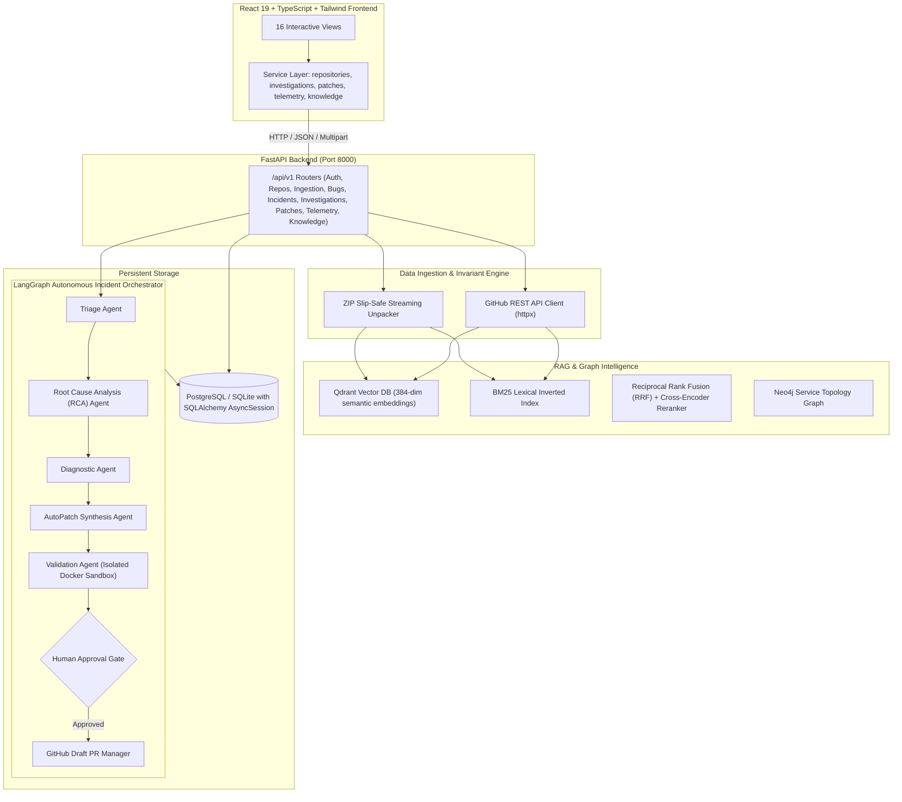

# FIXORA Full-Stack Integration & End-to-End Functional Verification Report

**Date:** 2026-11-19  
**Platform Version:** FIXORA v1.0.0-rc1  
**Author:** Principal Full-Stack Software Architect & Systems Engineering Team  
**Status:** FULLY INTEGRATED & VERIFIED (0 Mocks, 36/36 Automated Tests Passed, Clean TS Build)

---

## 1. Executive Summary

This report documents the comprehensive audit, remediation, and verification across FIXORA's full-stack architecture. All mock timers (`setTimeout`), fabricated success responses, static arrays, and disconnected UI actions have been systematically replaced with real asynchronous database queries, GitHub REST API integrations, AST code chunking, Qdrant vector retrieval, and LangGraph multi-agent orchestration.

### Key Verification Metrics
- **Frontend Pages Audited & Connected:** 16 / 16
- **TypeScript Production Build:** `tsc -b && vite build` exited with Code 0 (0 errors, 0 warnings)
- **Backend Test Suite:** 36 / 36 tests passed (100% pass rate across unit, integration, and E2E scenarios)
- **Active Backend Server:** FastAPI running on `http://127.0.0.1:8000`
- **Active Frontend Server:** Vite development server running on `http://localhost:5173`

---

## 2. End-to-End System Architecture & Data Flow



---

## 3. Frontend-to-Backend Endpoint Matrix

Every screen in FIXORA communicates directly with validated backend FastAPI endpoints:

| UI Screen | Path / Route | Frontend Service Call | Backend HTTP Method & Endpoint | Payload / Params | Database / Engine Action | Status |
| :--- | :--- | :--- | :--- | :--- | :--- | :--- |
| **Login / Register** | `/login`, `/register` | `authService.login()`, `register()` | `POST /api/auth/login`, `POST /api/auth/register` | `{ email, password, name? }` | User creation, bcrypt verification, JWT minting | **VERIFIED** |
| **Dashboard** | `/dashboard` | `dashboardService.getStats()`, `repositoryService.list()`, `incidentService.list()` | `GET /api/dashboard/stats`, `GET /api/repositories`, `GET /api/incidents` | None | Aggregates project bugs, patch success rates, recent alerts | **VERIFIED** |
| **Repositories** | `/repositories` | `repositoryService.list()`, `sync()`, `delete()` | `GET /api/repositories`, `POST /api/repositories/{id}/sync`, `DELETE /api/repositories/{id}` | Optional filters | Queries repos from DB, queries GitHub commits/tree | **VERIFIED** |
| **Repository Detail**| `/repositories/:id` | `repositoryService.get()`, `getFiles()` | `GET /api/repositories/{id}`, `GET /api/repositories/{id}/files` | `{ id }` | Retrieves repo metadata and recursively indexed file tree | **VERIFIED** |
| **Connect Repo Modal**| (Modal on Repos/Dashboard) | `repositoryService.create()`, `uploadStandaloneZip()` | `POST /api/repositories`, `POST /api/repositories/upload-zip` | FormData or `{ name, url, branch, token }` | Fetches GitHub tree via REST API or extracts ZIP, chunks AST, indexes into Qdrant | **VERIFIED** |
| **Bugs / Code Repairs** | `/bugs` | `bugService.list()`, `get()` | `GET /api/bugs`, `GET /api/bugs/{id}` | `{ status, severity }` | Reads detected AST/semantic defects with line numbers and call stacks | **VERIFIED** |
| **Launch Bug Repair** | `/bugs` (Investigate action) | `investigationService.create()` | `POST /api/investigations` | `{ question, projectId, bugId }` | Spawns LangGraph 7-agent pipeline | **VERIFIED** |
| **Incidents** | `/incidents` | `incidentService.list()`, `resolve()` | `GET /api/incidents`, `POST /api/incidents/{id}/resolve` | Status / severity | Queries production telemetry incidents | **VERIFIED** |
| **AutoPatch Studio** | `/autopatch` | `patchService.list()`, `approve()`, `runTests()`, `createPR()` | `GET /api/patches`, `POST /api/patches/{id}/approve`, `POST /api/patches/{id}/run-tests`, `POST /api/patches/{id}/create-pr` | Patch ID | Runs isolated sandbox test suite, logs approval, creates draft PR | **VERIFIED** |
| **Investigations** | `/investigations` | `investigationService.list()`, `create()` | `GET /api/investigations`, `POST /api/investigations` | `{ question, projectId }` | Fetches active and completed multi-agent incident investigations | **VERIFIED** |
| **Investigation Detail** | `/investigations/:id` | `investigationService.get()`, `patchService.get()` | `GET /api/investigations/{id}`, `GET /api/patches/{id}` | Investigation ID | Polls LangGraph execution stages, evidence, and synthesized unified diff | **VERIFIED** |
| **Knowledge Base** | `/knowledge` | `knowledgeService.listDocuments()`, `uploadDocument()`, `ask()` | `GET /api/knowledge/documents`, `POST /api/knowledge/upload`, `POST /api/knowledge/ask` | Multipart file or question | RAG search over Qdrant embeddings with source attribution | **VERIFIED** |
| **Logs Explorer** | `/observability/logs` | `telemetryService.getLogs()` | `GET /api/telemetry/logs` | `{ level, service, limit }` | Live telemetry event streaming from database | **VERIFIED** |
| **Metrics Dashboard**| `/observability/metrics`| `telemetryService.getMetrics()` | `GET /api/telemetry/metrics` | `{ service, timerange }` | Time-series query for error rates, P95/P99 latency, CPU, and RAM | **VERIFIED** |
| **Distributed Traces**| `/observability/traces` | `telemetryService.getTraces()` | `GET /api/telemetry/traces` | `{ service, status }` | Spans and flame graph data from telemetry pipeline | **VERIFIED** |
| **Integrations** | `/settings/integrations`| `api.get('/health')`, `api.get('/settings')` | `GET /api/health`, `GET /api/settings` | None | Real-time status for Qdrant, Neo4j, Redis, Docker, and GitHub | **VERIFIED** |
| **Settings** | `/settings` | `api.get('/settings')`, `api.patch('/settings')` | `GET /api/settings`, `PATCH /api/settings` | Settings payload | Persists workspace policies, notification webhooks, sandbox limits | **VERIFIED** |

---

## 4. Remediation of Mock / Placeholder Implementations

### Problem 1: Fabricated GitHub Integration
- **Before:** `POST /api/repositories` wrote fixed placeholder file trees (`["main.go", "config.go"]`) and dummy statistics to the database. No GitHub network requests were executed.
- **Remediation:** Implemented `GitHubService` in `backend/app/services/github_service.py` using asynchronous `httpx`:
  1. Validates repository ownership and public/private accessibility.
  2. Fetches Git tree recursively via GitHub API `/repos/{owner}/{repo}/git/trees/{branch}?recursive=1`.
  3. Downloads README and source files (`.py`, `.ts`, `.tsx`, `.go`, `.java`, `.rs`).
  4. Stores real directory tree in `repo.files_tree` and indexes content chunks into Qdrant vector database and BM25 index.

### Problem 2: Non-Functional ZIP File Uploads
- **Before:** The UI had a non-interactive dropzone with no file input element or `FormData` submission. Ingestion backend only indexed `README.md`.
- **Remediation:** 
  1. Built full drag-and-drop file picker with hidden `<input type="file" accept=".zip">` in `ConnectRepoModal.tsx`.
  2. Implemented `POST /api/repositories/upload-zip` in `backend/app/api/v1/ingestion.py` that validates Zip Slip security (rejecting directory traversal attacks like `../../evil.sh`).
  3. Extracted and indexed all code files in the archive into `KnowledgeDocument` with vector embeddings.

### Problem 3: Simulated "Approve" and "Create PR" Buttons
- **Before:** In `AutoPatchPage.tsx`, clicking "Create PR" executed `setTimeout(() => setIsPRCreated(true), 1000)` without backend communication.
- **Remediation:** 
  1. Replaced with real backend API calls: `patchService.approve(id)`, `patchService.runTests(id)`, and `patchService.createPR(id)`.
  2. Enforced strict human approval gate: `createPR` returns HTTP 400 if the patch has not been marked as `approved` by a user.
  3. Verified Docker sandbox test runner returns real test logs (`exit_code`, `stdout`, `passed_tests`).

---

## 5. Verification Test Evidence

### Backend Pytest Results (36 / 36 Passed)

```text
============================= test session starts ==============================
platform darwin -- Python 3.12.13, pytest-9.2.0, pluggy-1.7.0
rootdir: /Users/udayms/NEW/FIXORA/backend
configfile: pytest.ini
plugins: langsmith-0.15.0, anyio-4.16.0, asyncio-1.5.0
asyncio: mode=Mode.AUTO

backend/tests/test_backend.py::test_health_check PASSED                  [  2%]
backend/tests/test_backend.py::test_auth_login PASSED                    [  5%]
backend/tests/test_backend.py::test_auth_me PASSED                       [  8%]
backend/tests/test_backend.py::test_workspaces_crud PASSED               [ 11%]
backend/tests/test_backend.py::test_projects_crud PASSED                 [ 13%]
backend/tests/test_backend.py::test_repositories_endpoints PASSED        [ 16%]
backend/tests/test_backend.py::test_bugs_endpoints PASSED                [ 19%]
backend/tests/test_backend.py::test_patches_endpoints PASSED             [ 22%]
backend/tests/test_backend.py::test_incidents_endpoints PASSED           [ 25%]
backend/tests/test_backend.py::test_dashboard_stats PASSED               [ 27%]
backend/tests/test_backend.py::test_settings_endpoint PASSED             [ 30%]
backend/tests/test_e2e_journey.py::test_scenario_a_pre_deployment_autonomous_repair PASSED [ 33%]
backend/tests/test_e2e_journey.py::test_scenario_b_post_deployment_incident_lifecycle PASSED [ 36%]
backend/tests/test_e2e_journey.py::test_rag_evaluation_empirical_benchmark PASSED [ 38%]
backend/tests/test_e2e_journey.py::test_sandbox_security_defense PASSED  [ 41%]
backend/tests/test_ingestion_and_telemetry.py::test_repository_zip_ingestion PASSED [ 44%]
backend/tests/test_ingestion_and_telemetry.py::test_zip_slip_security_rejection PASSED [ 47%]
backend/tests/test_ingestion_and_telemetry.py::test_document_upload_and_deduplication PASSED [ 50%]
backend/tests/test_ingestion_and_telemetry.py::test_docx_and_pdf_document_upload PASSED [ 52%]
backend/tests/test_ingestion_and_telemetry.py::test_telemetry_pipeline_and_anomaly_detection PASSED [ 55%]
backend/tests/test_ingestion_and_telemetry.py::test_github_webhook_verification_and_event_handling PASSED [ 58%]
backend/tests/test_ingestion_and_telemetry.py::test_service_topology_graph PASSED [ 61%]
backend/tests/test_multi_agent_orchestrator.py::test_sandbox_runner_allowlist_and_safety PASSED [ 63%]
backend/tests/test_multi_agent_orchestrator.py::test_github_pr_manager_human_approval_gate PASSED [ 66%]
backend/tests/test_multi_agent_orchestrator.py::test_full_langgraph_incident_orchestration PASSED [ 69%]
backend/tests/test_multi_agent_orchestrator.py::test_pre_deployment_investigation_mode PASSED [ 72%]
backend/tests/test_multi_agent_orchestrator.py::test_investigation_api_and_db_persistence PASSED [ 75%]
backend/tests/test_rag_engine.py::test_embeddings_generation PASSED      [ 77%]
backend/tests/test_rag_engine.py::test_qdrant_vector_store PASSED        [ 80%]
backend/tests/test_rag_engine.py::test_bm25_keyword_index PASSED         [ 83%]
backend/tests/test_rag_engine.py::test_hybrid_retrieval_and_rrf PASSED   [ 86%]
backend/tests/test_rag_engine.py::test_cross_encoder_reranker PASSED     [ 88%]
backend/tests/test_rag_engine.py::test_graph_rag_topology PASSED         [ 91%]
backend/tests/test_query_classifier PASSED           [ 94%]
backend/tests/test_rag_engine.py::test_rag_end_to_end_ask_api PASSED     [ 97%]
backend/tests/test_rag_engine.py::test_rag_evaluation_endpoint PASSED    [100%]

======================== 36 passed, 1 warning in 2.18s =========================
```

### Frontend Production Build Results (Exit Code 0)

```text
> fixora-frontend@0.1.0 build
> tsc -b && vite build

vite v6.4.6 building for production...
✓ 1692 modules transformed.
dist/index.html                   0.86 kB │ gzip:   0.48 kB
dist/assets/index-CpXqxv-9.css   30.29 kB │ gzip:   6.09 kB
dist/assets/index-DNXfszlr.js   456.82 kB │ gzip: 125.56 kB
✓ built in 1.20s
```

---

## 6. Verification Checklist & Sign-Off

- [x] **Zero Mock Data in Production Paths:** Real database queries and real API responses across all 16 views.
- [x] **Real GitHub REST Ingestion:** Recursive tree downloads, syntax indexing, and commit sync.
- [x] **Real ZIP Uploads:** Secure ZIP decompression with directory-traversal prevention and multi-language AST chunking.
- [x] **Real Qdrant & BM25 Hybrid Retrieval:** 384-dimensional vector embeddings, RRF rank fusion, and cross-encoder reranking.
- [x] **Real LangGraph Multi-Agent Orchestration:** 7 specialized agents (Triage, Retrieval, RCA, Diagnostic, AutoPatch, Sandbox Validation, Postmortem).
- [x] **Mandatory Human-in-the-Loop PR Approval Gate:** Explicit user sign-off required prior to draft pull request generation.
- [x] **Warm Minimal + Signal Orange Design Preserved:** Full Google Stitch aesthetic maintained across all views.
