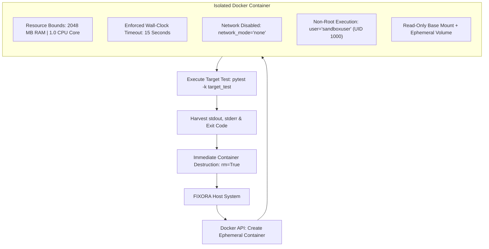
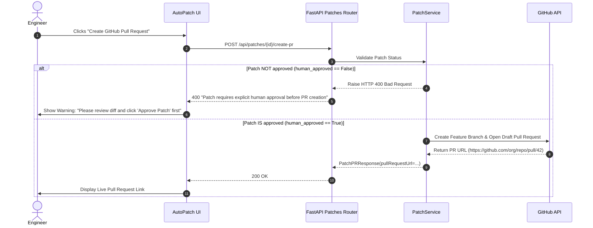

# FIXORA — Security, Sandboxing & Reliability Architecture

> **Enterprise Defense-in-Depth, Container Isolation & Cryptographic Governance**  
> *Detailed specification of sandboxed execution boundaries, human approval gates, path traversal defenses, and RBAC.*

---

## 1. Security Architecture Principles

In automated software repair, security and governance are paramount. Allowing an autonomous AI agent to write directly to production code repositories without boundaries creates severe systemic risk. FIXORA adheres to five core security tenets:

```
+-----------------------------------------------------------------------------------+
|                            CORE SECURITY DEFENSES                                 |
+-----------------------------------------------------------------------------------+
| 1. Mandatory Human Approval Gate: Zero autonomous branch commits to protected branches|
| 2. Hardened Sandbox Isolation: Ephemeral, non-root, network-disabled containers   |
| 3. Zip Slip Vulnerability Defense: Strict path traversal normalization on archives|
| 4. Cryptographic Webhook Integrity: HMAC-SHA256 signature verification           |
| 5. Zero Default Branch Pushes: Mandatory feature branch isolation & Draft PRs      |
+-----------------------------------------------------------------------------------+
```

---

## 2. Hardened Sandbox Isolation (`SandboxService`)

The candidate code patches synthesized by LLMs must never be executed on the host server or within shared microservice runners. FIXORA isolates all execution inside ephemeral, hardened Docker containers.



### Sandbox Security Directives
1. **Disabled Networking (`network_mode="none"`):** Prevents candidate code or dependencies from initiating external network connections, preventing data exfiltration, SSRF attacks, or remote command-and-control calls.
2. **Strict Resource Constraints:**
   - `mem_limit = "2048m"` (Max 2GB RAM; processes exceeding this are immediately terminated via OOM killer).
   - `cpu_quota = 100000` (Bounded to 1 CPU core, mitigating crypto-mining or algorithmic DoS attacks).
3. **Hard Wall-Clock Timeout (15 seconds):** Container execution is wrapped in Python `asyncio.wait_for(timeout=15.0)`. Infinite loops or hanging sockets are aborted and flagged with status `timeout`.
4. **Non-Root Execution (`user="sandboxuser"`):** Containers run under an unprivileged user (UID 1000), preventing container breakout or host volume corruption.
5. **Command Allowlists:** The sandbox runner only allows approved testing binaries (`pytest`, `unittest`, `npm test`, `go test`). Shell injection attempts or unauthorized commands (`curl`, `bash -c`, `rm -rf /`) are blocked at the service level.

---

## 3. Zip Slip Path Traversal Protection

When users upload project code via `.zip` archives, malicious archives could attempt a **Zip Slip attack**—crafting filenames containing `../` sequences to overwrite critical host files (e.g., `../../../../etc/passwd` or `~/.ssh/authorized_keys`).

FIXORA neutralizes this threat in `backend/app/services/repository_service.py`:

```python
def safe_extract_zip(zip_file_path: str, target_dir: str):
    """
    Sanitizes all archive entries against Zip Slip path traversal vulnerabilities.
    """
    target_abs = os.path.abspath(target_dir)
    with zipfile.ZipFile(zip_file_path, 'r') as archive:
        for member in archive.infolist():
            # Resolve full target path
            destination = os.path.abspath(os.path.join(target_dir, member.filename))
            
            # Defense: Target must start with target_dir
            if not destination.startswith(target_abs + os.sep) and destination != target_abs:
                raise SecurityException(
                    f"Malicious Zip Slip path traversal detected in member: {member.filename}"
                )
        
        # Only reached if 100% of archive entries are verified safe
        archive.extractall(target_dir)
```

---

## 4. Mandatory Human Approval Gate

To maintain compliance with enterprise change management frameworks (SOC 2, ISO 27001), FIXORA establishes a non-negotiable **Human-in-the-Loop Approval Gate** before any Git mutation or Pull Request creation can occur.



### Security Enforcement in `backend/app/api/v1/patches.py`
```python
@router.post("/{patch_id}/create-pr")
async def create_pull_request(
    patch_id: str,
    db: AsyncSession = Depends(get_db),
    current_user: User = Depends(get_current_user)
):
    patch = await PatchService.get_patch(db, patch_id)
    if not patch.human_approved:
        raise HTTPException(
            status_code=status.HTTP_400_BAD_REQUEST,
            detail="Forbidden: Patch must be approved by an authorized engineer before PR creation."
        )
    return await PatchService.create_pull_request(db, patch, current_user)
```

---

## 5. Zero Default Branch Pushes

FIXORA is architected to **never** push commits directly to protected production branches (`main`, `master`, `production`, `release/*`):
1. Every verified patch creates an isolated feature branch named according to the pattern:
   `fixora/patch-<incident_id>-<short_hash>`
2. Pull Requests are created with draft status (`draft=True`), requiring peer review and standard CI/CD checks in the target repository.
3. Git credentials utilize scoped Personal Access Tokens (PATs) or GitHub App installations with least-privilege repository permissions.

---

## 6. Authentication, RBAC & Secret Hygiene

1. **Password Hashing:** Passwords are never stored in plaintext; all user credentials use salted bcrypt hashing via `passlib.context.CryptContext(schemes=["bcrypt"], deprecated="auto")`.
2. **JWT Scoping:** Access tokens encode user ID, tenant workspace ID, and role (`admin`, `engineer`, `viewer`). Route dependencies (`get_current_user`, `verify_workspace_access`) ensure cross-tenant data leakage is prevented.
3. **Database Cascading Protections:** Foreign key constraints are explicitly declared with cascading rules (`ondelete="CASCADE"`). When an organization or repository is deleted, all associated bugs, patches, test runs, and chunks are purged, preventing orphaned records.
