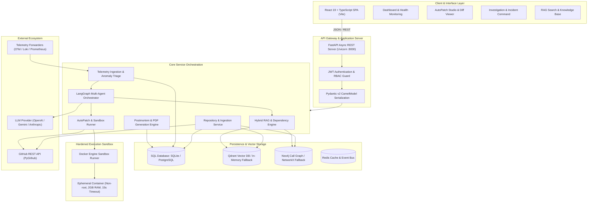
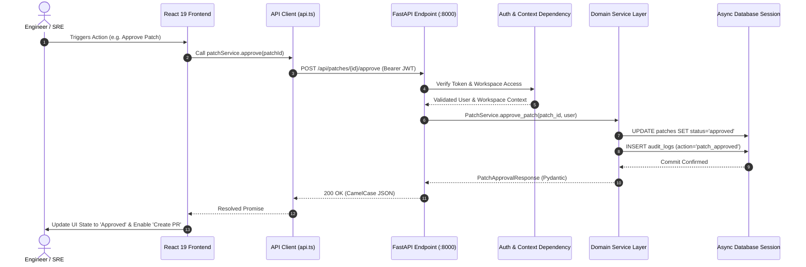
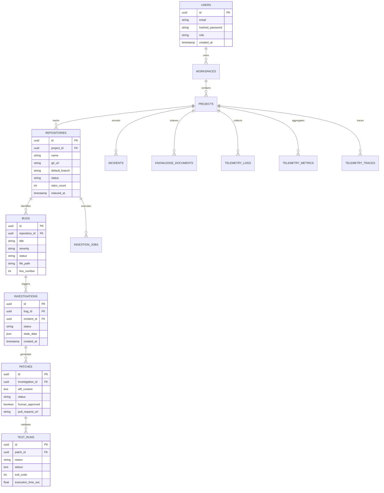
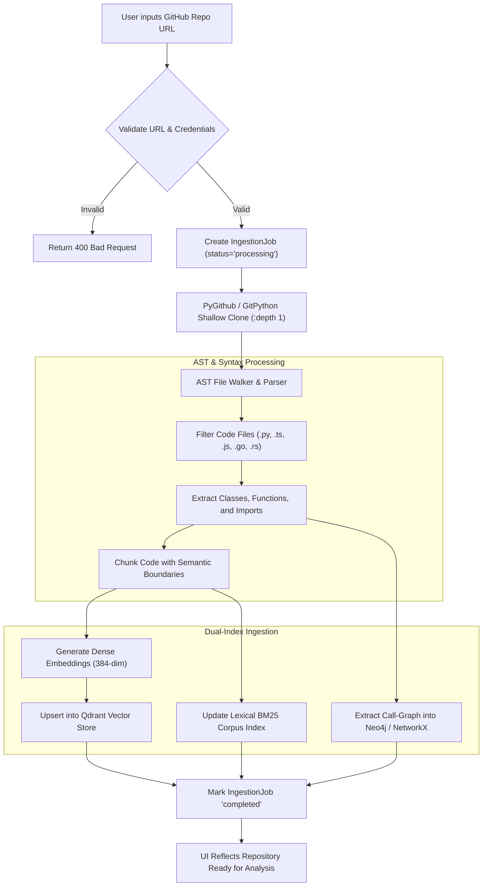
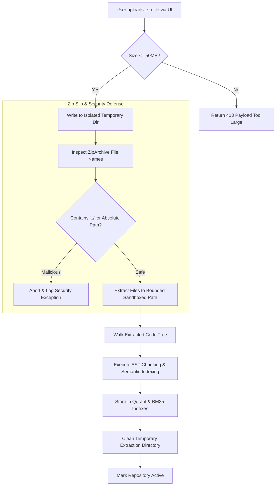
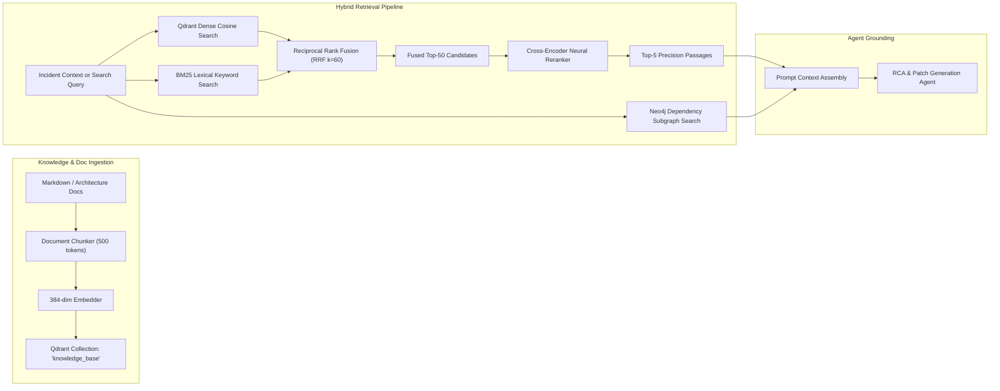
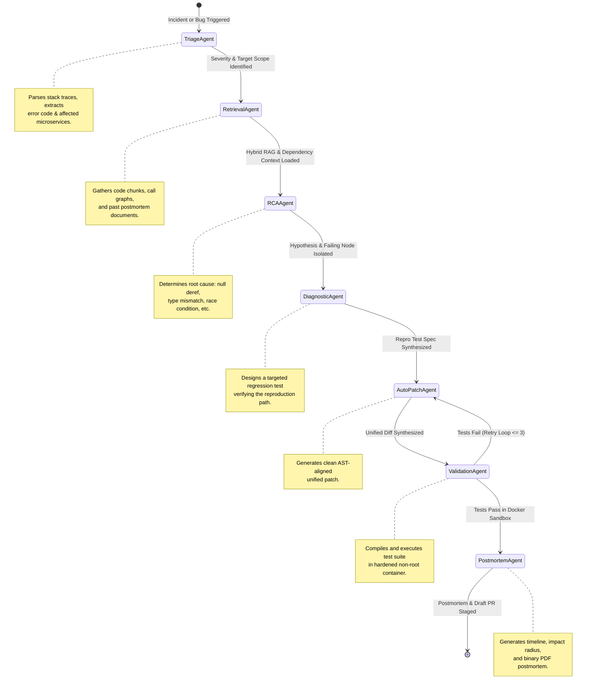
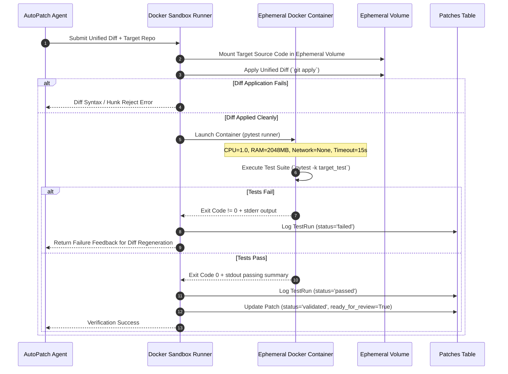
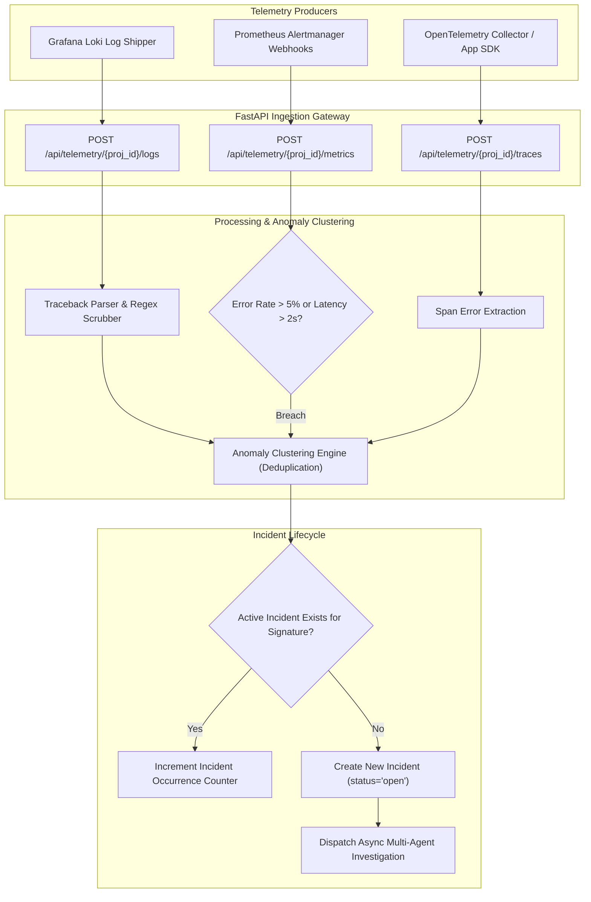
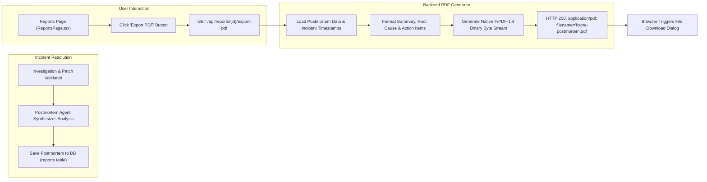

# FIXORA — Complete System Architecture & Visual Diagrams

> **Structural Topologies, Component Interactions & End-to-End Diagrams**  
> *Ten comprehensive Mermaid diagrams documenting the architectural fabric of FIXORA.*

---

## 1. High-Level System Architecture

---

## 2. Frontend-to-Backend Communication Flow

---

## 3. Database Architecture & Entity Relationships

---

## 4. GitHub Ingestion Pipeline

---

## 5. ZIP Ingestion Pipeline & Security Sandbox

---

## 6. Knowledge Base & Hybrid RAG Pipeline

---

## 7. AI Investigation Multi-Agent Pipeline (LangGraph)

---

## 8. AutoPatch Validation Pipeline & Sandbox Execution

---

## 9. Observability & Telemetry Ingestion Pipeline

---

## 10. Postmortem & Binary PDF Export Pipeline

